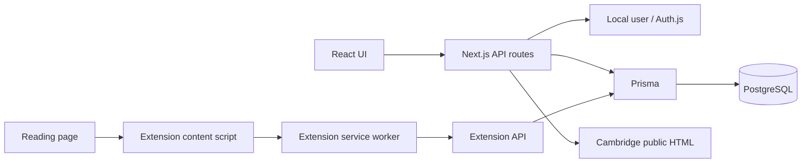

# Architecture

Wordgarden uses Next.js 16 App Router, React 19, TypeScript, PostgreSQL 17, Prisma 6, Auth.js, Zod, Cheerio, and a Chrome/Edge Manifest V3 extension. The web app is a client-side interface backed by Next route handlers. Prisma reads and writes per-user records. Cheerio parses public Cambridge HTML on the server. The extension has a popup, background service worker, and page content script.

`src/components/garden.tsx` contains the library, editor, review, settings, and print views. `src/app/api/[...path]/route.ts` serves the main JSON API; `src/app/api/extension/[action]/route.ts` serves capture. `src/lib/model.ts` defines Zod content and scheduling logic; `src/lib/user.ts` resolves users and validates request origin; `src/lib/cambridge.ts` performs lookup. `prisma/schema.prisma` defines the tables. `extension/` contains the browser code; `scripts/` contains smoke and backup helpers; `tests/` contains automated tests.

The Docker image builds a standalone Next.js server. Compose starts a database, one-shot migration service, and web service in dependency order. See [workflows](workflows.md), [data model](data-model.md), and [developer setup](developer-setup.md).
